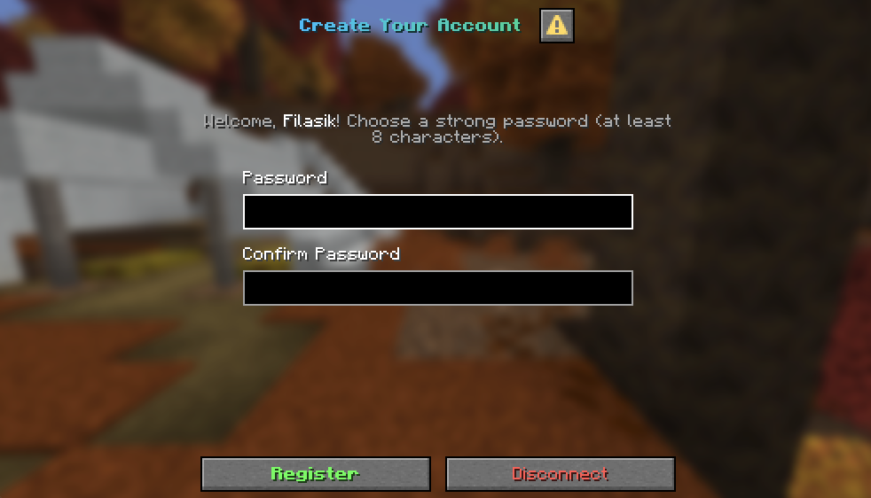
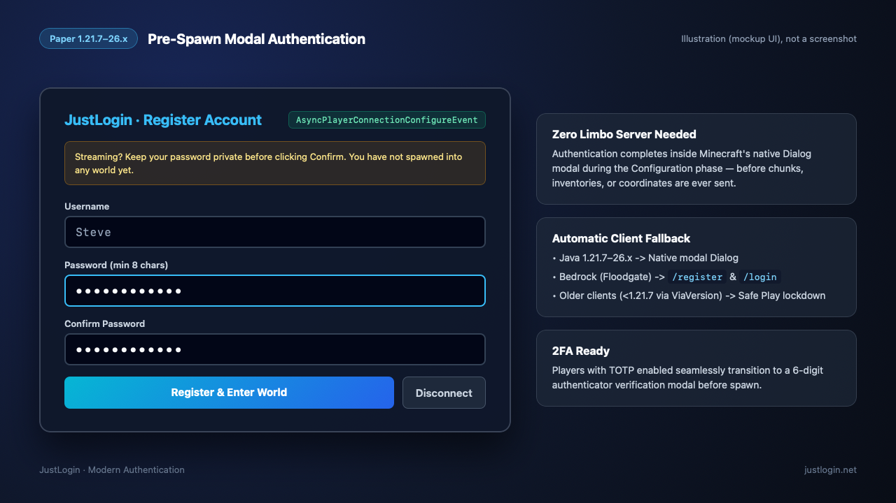
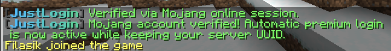
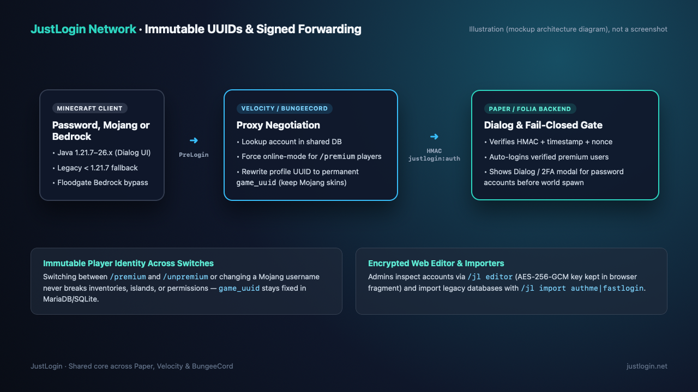
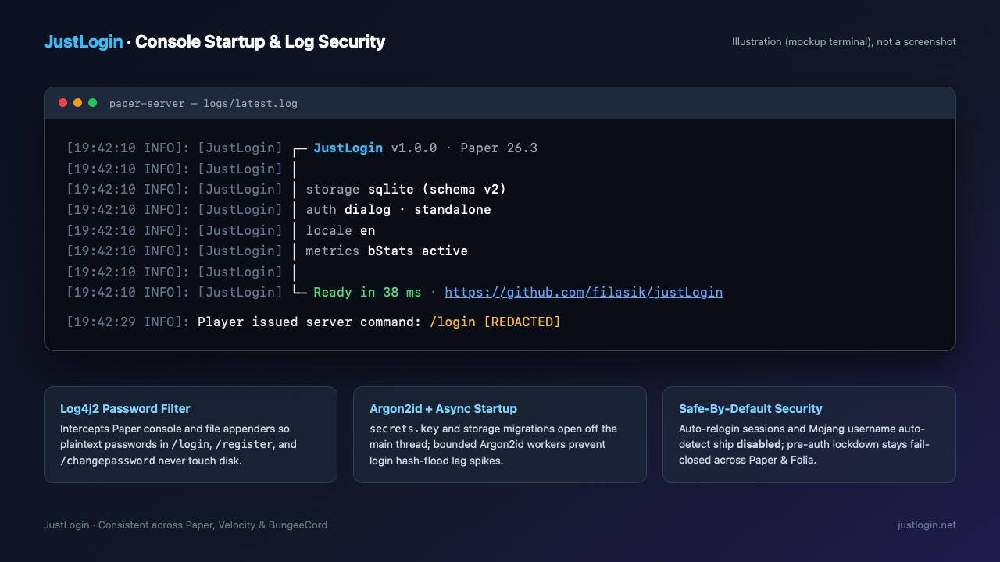
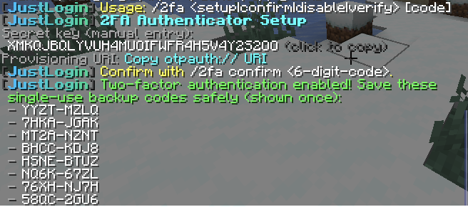
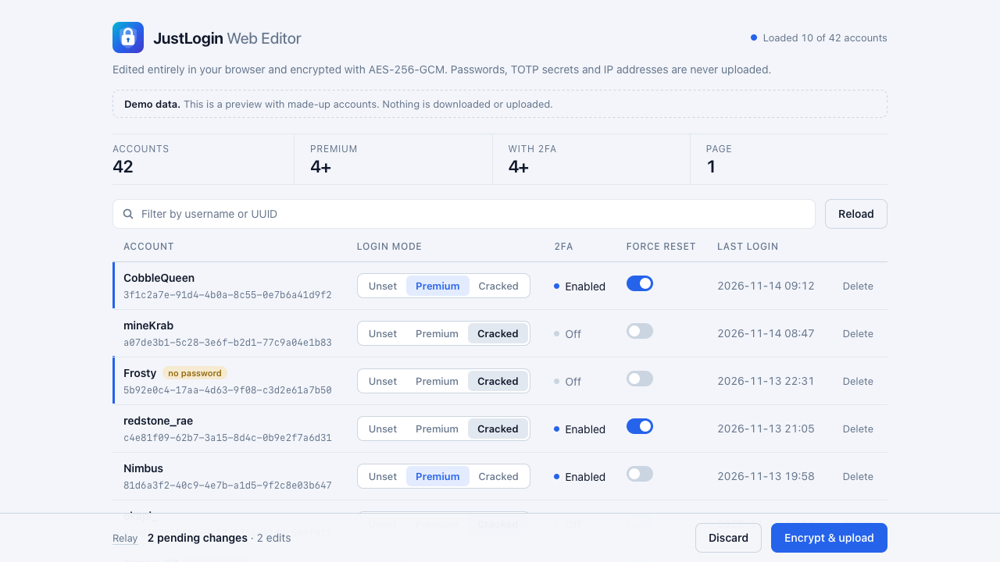

<div align="center">


# JustLogin

**Modern account authentication for Paper `1.21.7–26.x`, Folia, Velocity, and BungeeCord.**  
Native **Configuration-phase Paper Dialogs**, **Argon2id** hashing, **standalone & proxy `/premium` Mojang auto-login**, **custom skin management (`/skin`)**, **immutable server UUIDs**, **RFC 6238 2FA**, **SMTP email recovery**, and an **AES-256-GCM encrypted Web Editor**.

[](https://papermc.io)
[](https://papermc.io/software/velocity)
[](https://papermc.io/software/folia)
[](https://adoptium.net)
[](LICENSE)

**[justlogin.net](https://justlogin.net)** · Built in the same family alongside [JustPolls](https://github.com/filasik/justPolls) and [JustAuction](https://github.com/filasik/justAuction)

</div>

---

## Why JustLogin?

Traditional authentication plugins drop unauthenticated players into a live world (or require a separate limbo server) and freeze movement on every tick while spamming chat. **JustLogin** rethinks authentication for modern Paper servers:

- **Authenticate Before World Spawn (`1.21.7+`)** — Uses Minecraft's native **Configuration-phase Dialog UI** (`AsyncPlayerConnectionConfigureEvent`) so players register, log in, or enter their 2FA code in a clean modal dialog *before chunks, inventories, or coordinates are ever sent*.
- **Standalone & Proxy `/premium` Auto-Login** — Paid Mojang players can enable `/premium` with **zero external dependencies** (works directly on standalone Paper via Netty encryption handshakes + Mojang `hasJoined`, as well as on Velocity and BungeeCord) while **keeping their original server `game_uuid`**.
- **Built-In Skin Management (`/skin`)** — Applies matching Mojang skins by username for players who log in with a password (configurable, strictly cosmetic — never bypasses authentication or grants `/premium`) and provides `/skin <player|reset>` + `/jl skin <player> <target|reset>` with instant live updates, database persistence, and cooldown protection. No external skin plugin required.
- **Argon2id + Zero Main-Thread I/O** — Memory-hard Argon2id hashing (`19 MiB` default) inside a bounded worker pool prevents hash-flood DoS attacks and transparently upgrades legacy AuthMe (`SHA-256`, `SHA-512`), `BCrypt`, and `PBKDF2` hashes on login.
- **Complete Account Security** — RFC 6238 TOTP 2FA with 8 single-use backup codes, anti-bot `/captcha`, optional zero-dependency `STARTTLS`/`SSL` SMTP `/email` password recovery, Log4j2 password redaction, and an encrypted Web Editor (`https://justlogin.net`).

---

## 1. Native Configuration-Phase Dialogs (`1.21.7–26.x`)

When a `1.21.7+` Java client connects, JustLogin pauses the connection inside the **Configuration phase** and opens a native Minecraft Dialog screen. The player never enters the world until authenticated:

<div align="center">
  
  <br>
  <em>In-game screenshot: Native Configuration-phase Paper Dialog modal shown before world spawn.</em>
</div>

<br>

- **Single-Password or Confirm Mode** — `login.dialog-single-password: true` (default) lets new players register with a single password field for frictionless onboarding, or set `false` to show both *Password* and *Confirm Password* fields (as pictured above).
- **Automatic Client Fallback** —
  - **Java `1.21.7–26.x`**: Native Configuration-phase Dialog modals (register, login, 2FA, forced password change)
  - **Bedrock (Floodgate / Geyser)**: Optional **Cumulus** native Bedrock forms (`bedrock.cumulus-forms: true`) or chat command fallback
  - **Older clients (`< 1.21.7` via ViaVersion)** or `login.ui: command`: Full pre-auth Play-phase lockdown with `/register` and `/login`

<div align="center">
  
</div>

---

## 2. Standalone & Proxy `/premium` Auto-Login (Immutable `game_uuid`)

When an account moves between password login and Mojang-verified login, the player's UUID would normally change — wiping inventories, ender chests, economy balances, LuckPerms data, and land claims.

**JustLogin solves this permanently:** every account receives an immutable **`game_uuid`** on first join that never changes, even when toggling `/premium` / `/unpremium` or renaming a Mojang account.

### How `/premium` works in-game

1. **Arm verification**: An authenticated player with a paid Minecraft account runs `/premium`:

<div align="center">
  
</div>

2. **Reconnect & auto-login**: On their next join, JustLogin performs a full RSA + AES-CFB8 encryption handshake and verifies the session against Mojang's `sessionserver` (`hasJoined`). If the connecting client cannot present a verified Mojang session, JustLogin safely rolls back the pending request so the player is never locked out of their account.

<div align="center">
  
</div>

### Works on Standalone Paper AND Velocity / BungeeCord

- **Standalone Paper (`premium.standalone-enabled: true`)** — Works out of the box on a single Paper server with **no proxy, no ProtocolLib, and no PacketEvents**. JustLogin intercepts the login handshake directly on Paper's Netty pipeline, verifies Mojang encryption, applies the player's Mojang skin textures, and keeps their permanent `game_uuid` via `AsyncPlayerPreLoginEvent`.
- **Velocity & BungeeCord Networks (`proxy.enabled: true`)** — `JustLogin-Velocity` / `JustLogin-Bungee` handles Mojang online-mode negotiation and UUID rewriting at the proxy edge, then forwards an **HMAC-SHA256 signed token** (`justlogin:auth`) with timestamp + single-use nonce to your Paper backends. Optional `proxy.auth-servers` keeps unauthenticated players on designated auth/lobby servers until `BACKEND_AUTH_OK` is received.

<div align="center">
  
</div>

---

## 3. Defense-in-Depth Security, 2FA, Captcha & Email Recovery

<div align="center">
  
</div>

- **Argon2id + Automatic Legacy Rehash** — Passwords are hashed with **Argon2id** (`19 MiB` memory, `2` iterations, `1` parallelism) on a bounded worker pool (`HASHING_BUSY` backpressure protects TPS). Imported AuthMe `SHA-256` / `SHA-512`, `BCrypt`, and `PBKDF2` hashes are transparently upgraded to Argon2id the first time the player logs in.
- **RFC 6238 TOTP 2FA & Backup Codes** — Players can enable authenticator-app 2FA via `/2fa setup` and `/2fa confirm <code>`. Secrets are encrypted with **AES-256-GCM** using `plugins/JustLogin/secrets.key` (kept separate from the SQL database), verified TOTP time-steps are tracked to block replay attacks, and 8 single-use hashed backup codes are generated on setup.

<div align="center">
  
  <br>
  
  <br>
  <em>In-game screenshots: TOTP 2FA setup with clickable <code>otpauth://</code> URI & single-use backup codes, plus login verification prompt.</em>
</div>

- **Anti-Bot `/captcha` & Isolated Rate-Limiting** — Configurable alphanumeric Captcha challenges trigger after `captcha.trigger-after-failures: 3` failed login attempts (or on registration when `captcha.require-on-register: true`). Per-account and per-IP rate limits are isolated so a shared NAT/school IP never locks out innocent players prematurely.
- **Zero-Dependency SMTP Email Recovery** — Players can link and verify an email with `/email set <address> <password>` + `/email confirm <code>` and recover forgotten passwords via `/email recover <username> [code] [newPassword]` over `STARTTLS` or `SSL/TLS` without bundling heavy Jakarta Mail dependencies.
- **Log4j2 Password Redaction (`LogPasswordFilter`)** — Automatically strips `/login`, `/register`, `/changepassword`, `/unregister`, `/unpremium`, `/2fa`, `/email set`, `/email confirm`, `/email recover`, and `/jl changepassword` arguments before they ever reach the console or `logs/latest.log`.
- **Safe-by-Default Configuration** —
  - IP-bound HMAC auto-relogin sessions are **off by default** (`sessions.enabled: false`)
  - Unsolicited Mojang username auto-detection is **off by default** (`premium.auto-detect-mojang: false`)
  - Fail-closed startup checks verify Paper proxy forwarding (`paper-global.yml` / `spigot.yml`) and require a `>= 16`-character `proxy.shared-secret`

---

## 4. In-Game Admin GUI, Account Management, Importers & Web Editor

- **Paginated Admin GUI (`/jl gui [page]`)** — Browse all registered accounts in a 54-slot chest UI (strictly click/drag-locked). Left-click to toggle `force_password_change`, Shift+Left-click to reset 2FA, Right-click to inspect full account status in chat, or Shift+Right-click to unregister.
- **Account Rename & Transactional Merge** —
  - `/jl rename <oldName> <newName>` renames an account in-place while preserving its exact `game_uuid`.
  - `/jl merge <source> <target>` transactionally merges `source` into `target` (preserving the target's `game_uuid` and carrying over linked `premium_uuid` / email metadata if missing).
- **1-Click Auto-Migration (`/jl import`)** — Automatically scans `plugins/` for existing **AuthMe**, **FastLogin**, **LibreLogin / LibrePremium**, **LoginSecurity**, **nLogin**, **OpeNLogin**, **LimboAuth**, and **Authy** configurations/databases (reading real-world tables like `librepremium_data`, `ls_players`, `openlogin`, `AUTH`, `players`, plus `database.yml` / `config.conf` MySQL & SQLite settings), normalizes legacy split `BCrypt-2A` / `Argon-2ID` and SHA digests, supports `--dry-run` previews, preserves permanent `game_uuid` across AuthMe + FastLogin migrations, imports emails & TOTP secrets, and writes a detailed `plugins/JustLogin/import-report-<timestamp>.txt`.
- **AES-256-GCM Encrypted Web Editor (`https://justlogin.net` or Localhost HTTP)** —
  - `/jl editor [page]` exports a paginated YAML snapshot encrypted client-side with **AES-256-GCM** (the decryption key stays in the URL `#fragment` and is never transmitted to the relay server).
  - Hosted live at **[justlogin.net](https://justlogin.net)**, or set `editor.local-http.enabled: true` to serve the bundled SPA directly on `http://127.0.0.1:8787/`.
  - Review changes in-game with `/jl applyedits <code>` and commit with `/jl applyedits confirm`.

<div align="center">
  
  <br>
  <em>JustLogin Web Editor (<code>justlogin.net</code> / local loopback): zero plaintext secrets leave your server — everything is encrypted client-side with AES-256-GCM.</em>
</div>

---

## External connections & privacy

JustLogin only talks to the following services. Nothing else is contacted, and no player passwords ever leave your server.

| Service | Purpose | Can be disabled |
| :--- | :--- | :--- |
| Mojang `sessionserver.mojang.com` | Verifies `/premium` sessions (`hasJoined`) and fetches signed skin textures for `/skin` | `premium.standalone-enabled: false`, `skins.enabled: false` |
| GitHub Releases API | Update check (initial + every 12 h) | `update-check: false` |
| [bStats](https://bstats.org) | Anonymous usage statistics (plugin ID 35316) | `metrics: false` (or the global bStats opt-out) |
| Web Editor relay (`justlogin.net` / Bytebin) | Receives only an **AES-256-GCM encrypted** snapshot; the decryption key stays in the URL fragment | Don't use `/jl editor`, or set `editor.local-http.enabled: true` for a loopback-only editor |
| Your SMTP server | Sends account recovery emails | Leave SMTP unconfigured |

---

## Quick Start

### Standalone Paper Server

1. Drop `JustLogin-1.0.2.jar` into `plugins/` on a **Paper `1.21.7–26.x`** server (`Java 21+`) and start the server.
2. On first boot, `JustLoginLoader` downloads runtime libraries (`libraries.txt`), generates `plugins/JustLogin/secrets.key`, initializes `plugins/JustLogin/data/justlogin.db` (SQLite), and extracts `messages_en.yml`, `messages_cs.yml`, and `messages_sk.yml`.
3. Everything works out of the box — including native Configuration-phase Dialogs (`1.21.7+`) and standalone `/premium` verification. Adjust `plugins/JustLogin/config.yml` anytime and run `/jl reload`.

### Velocity or BungeeCord Network

1. Place `JustLogin-Velocity-1.0.2.jar` on Velocity (or `JustLogin-Bungee-1.0.2.jar` on BungeeCord) and `JustLogin-1.0.2.jar` on every Paper backend.
2. Generate a random `proxy.shared-secret` (at least 16 characters) and set the **exact same secret** in both proxy and Paper `config.yml`.
3. Configure the **same MariaDB database** under `storage` in both proxy and Paper `config.yml`.
4. Set `proxy.enabled: true` and `proxy.mode: velocity` (or `bungee`) on Paper, matching Paper's native forwarding (`config/paper-global.yml` for Velocity modern forwarding or `spigot.yml` for BungeeCord).

---

## Commands & Permissions

| Command | Aliases | Permission | Description |
| :--- | :--- | :--- | :--- |
| `/register <pw> <pw>` | `/reg` | `justlogin.use` | Register a new account |
| `/login <pw>` | `/l` | `justlogin.use` | Authenticate an existing account |
| `/logout` | — | `justlogin.use` | End active authenticated session |
| `/changepassword <old> <new>` | `/changepass`, `/cp` | `justlogin.use` | Change your account password |
| `/unregister <pw>` | — | `justlogin.use` | Permanently delete your own account |
| `/captcha <code>` | — | `justlogin.use` | Complete pre-auth anti-bot captcha challenge |
| `/email <set\|confirm\|clear\|recover>` | — | `justlogin.email` | Verify/clear recovery email or recover password via SMTP |
| `/2fa <setup\|confirm\|disable\|verify>` | — | `justlogin.2fa` | Set up, disable, or verify RFC 6238 TOTP 2FA |
| `/premium` | — | `justlogin.premium` | Arm Mojang online auto-login (standalone Paper & proxy) |
| `/unpremium [password]` | — | `justlogin.premium` | Switch back to password authentication (the `[password]` is only needed if your account has none yet) |
| `/skin <player\|reset>` | `/skins` | `justlogin.skin` | Change or reset your player skin with persistent storage |
| `/jl help [page\|topic\|cmd]` | `/justlogin help`, `/jl ?` | `justlogin.use` | Interactive paginated help and command detail cards |
| `/justlogin reload` | `/jl`, `/auth` | `justlogin.admin.reload` | Reload `config.yml` and locale messages |
| `/jl status <player>` | — | `justlogin.admin.status` | Inspect account UUIDs, hash algorithm, 2FA & premium status |
| `/jl audit [limit]` | — | `justlogin.admin.audit` | View recent security audit log entries |
| `/jl unregister <player>` | — | `justlogin.admin.unregister` | Admin remove an account |
| `/jl changepassword <player> <pw>` | `/jl changepass` | `justlogin.admin.changepass` | Admin reset a player's password |
| `/jl forcechangepassword <player> <bool>` | `/jl forcepw` | `justlogin.admin.forcepw` | Require password change on next login |
| `/jl reset2fa <player>` | — | `justlogin.admin.reset2fa` | Disable TOTP 2FA and clear backup codes |
| `/jl setpremium <player> <bool>` | — | `justlogin.admin.setpremium` | Admin toggle Mojang online mode flag |
| `/jl rename <old> <new>` | — | `justlogin.admin.rename` | Rename account while preserving `game_uuid` |
| `/jl merge <source> <target>` | — | `justlogin.admin.merge` | Merge source account into target account |
| `/jl gui [page]` | — | `justlogin.admin.gui` | Open paginated in-game admin account browser |
| `/jl import [auto\|authme\|fastlogin\|librelogin\|loginsecurity\|nlogin\|openlogin\|limboauth\|authy] [--dry-run] [--ssl-mode=<mode>] [--keep-offline-uuid]` | — | `justlogin.admin.import` | 1-click auto-migration or manual SQLite / MariaDB import |
| `/jl skin <player> <target\|reset>` | — | `justlogin.admin.skin` | Set or reset another player's saved skin as an administrator |
| `/jl editor [page]` | — | `justlogin.editor` | Export AES-256-GCM encrypted Web Editor session |
| `/jl applyedits <code\|confirm>` | — | `justlogin.editor` | Preview diff and apply Web Editor changes |

> All `justlogin.admin.*` sub-permissions are granted automatically by `justlogin.admin` (default: `op`). Full Brigadier tab-completion is supported across all commands and stored account names.

---

## Configuration

All settings live in `plugins/JustLogin/config.yml` (`config-version: 5`). When updating the plugin, `ConfigUpdater` automatically backs up `config.yml.bak-v<n>` and merges new keys and comments without overwriting your settings:

```yaml
locale: en                        # en (English), cs (Czech), or sk (Slovak)
update-check: true                # async GitHub Releases check
metrics: true                     # anonymous bStats telemetry (plugin ID 35316)

login:
  ui: dialog                      # dialog (Paper 1.21.7+ Configuration modal) | command
  dialog-single-password: true    # true = 1 password field on register Dialog; false = password + confirm
  timeout-seconds: 60

bedrock:
  cumulus-forms: true             # use Floodgate Cumulus forms when available

captcha:
  enabled: true
  require-on-register: false
  trigger-after-failures: 3

sessions:
  enabled: false                  # opt-in IP-bound HMAC auto-relogin sessions

premium:
  standalone-enabled: true        # direct Mojang encryption handshake on standalone Paper
  auto-detect-mojang: false       # opt-in Mojang username lookup on first join

skins:
  enabled: true                   # built-in skin restoration & /skin command
  restore-by-name: true           # auto-apply the matching Mojang skin for password logins (cosmetic only)
  command-enabled: true           # allow authenticated players to run /skin <player|reset>
  cooldown-seconds: 60
  cache-seconds: 600

proxy:
  enabled: false                  # true when behind Velocity or BungeeCord
  mode: standalone                # standalone | velocity | bungee
  shared-secret: ""               # >= 16 random chars shared with Velocity/Bungee

editor:
  web-url: "https://justlogin.net" # hosted web editor
  local-http:
    enabled: false                # optional 127.0.0.1:8787 local browser editor

storage:
  type: sqlite                    # sqlite (default) | mariadb
```

---

## Developer API

Other plugins can query authentication state, inspect sanitized account metadata (`AccountSnapshot`), and listen to lifecycle events via Bukkit's `ServicesManager`:

```java
JustLoginAPI api = Bukkit.getServicesManager().load(JustLoginAPI.class);
if (api != null && api.isAuthenticated(player)) {
    api.findAccount(player.getUniqueId()).thenAccept(optSnapshot -> {
        optSnapshot.ifPresent(account -> {
            UUID permanentUuid = account.gameUuid();
            boolean premium = account.premiumConfirmed();
        });
    });
}
```

- **Events (`me.skerik.justlogin.api.event.*`)**: `PlayerAuthenticatedEvent`, `PlayerRegisteredEvent`, `PlayerLoggedOutEvent`, `PlayerPremiumVerifiedEvent`.
- **Privacy by design**: `AccountSnapshot` never exposes password hashes, TOTP secrets, IP hashes, email addresses, or recovery tokens.

---

## Security & Privacy Notes

- **Vanilla Dialog password input is visually unmasked**: Minecraft's native Dialog text input displays characters as typed on screen. JustLogin displays a warning icon in the modal header; servers preferring masked chat input can set `login.ui: command`.
- **`secrets.key` separation**: `plugins/JustLogin/secrets.key` keeps `hmac-key`, `totp-key`, and `proxy-secret` out of the SQL database (protecting SQL backups/dumps). Host-level compromise still exposes local files.
- **Web Editor relay & PII**: Although `/jl editor` payloads are encrypted with AES-256-GCM and the key never leaves `#fragment`, encrypted account usernames/UUIDs are uploaded to `editor.relay-url`. For strict local-only editing, use `editor.local-http.enabled: true` (`127.0.0.1` loopback) or `/jl gui`.

---

## Building & Testing

```bash
./gradlew build              # compile all 5 modules (-Xlint:all -Werror, Java 21) & run unit/security suites
./scripts/smoke-test.sh      # launch Paper server, verify startup banner, standalone hook, bStats & schema migrations
./scripts/render-assets.sh   # render docs/assets/* and docs/gallery/* PNGs from SVG/HTML sources
```

Output JARs after build:
- `paper/build/libs/JustLogin-1.0.2.jar`
- `velocity/build/libs/JustLogin-Velocity-1.0.2.jar`
- `bungee/build/libs/JustLogin-Bungee-1.0.2.jar`

---

## Documentation & Links

- **Website**: [justlogin.net](https://justlogin.net)
- **Modrinth / Hangar description**: [`docs/modrinth.md`](docs/modrinth.md)
- **SpigotMC BBCode**: [`docs/spigot.bbcode.txt`](docs/spigot.bbcode.txt)
- **Gallery**: [`docs/gallery/`](docs/gallery/README.md)
- **Security policy**: [`SECURITY.md`](SECURITY.md) · **Contributing**: [`CONTRIBUTING.md`](CONTRIBUTING.md)
- **License**: [MIT](LICENSE) © Filip Skerik

## Support the project

JustLogin is free and MIT-licensed, and every security feature stays free. If it saves you time, you can support development voluntarily (no in-game perks, ever):

- [Donate via PayPal](https://www.paypal.com/donate/?hosted_button_id=94D2D46EHKU5S)

Stars, bug reports and migration feedback help just as much.
