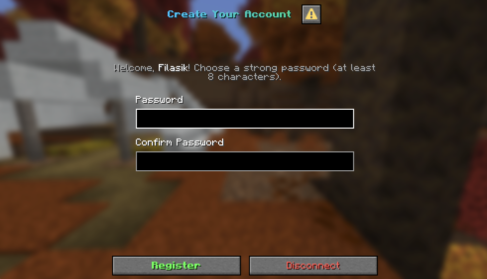

# Player Guide

Copy and adapt this page for your players. Server owners: see [Configuration](Configuration) for what can be turned on or off.

## Registering and logging in

### Java Edition `1.21.7` or newer

When you connect, a window opens **before** the world loads:



1. **First time** – enter a password (and confirm it, if asked) and press **Register**.
2. **Next time** – enter your password and press **Login**.
3. If you enabled 2FA, you will be asked for a 6-digit code afterwards.

> ⚠️ Minecraft's dialog shows what you type on screen (it is not masked). Do not log in while streaming or sharing your screen, or ask your server to switch to command mode.

### Older clients, Bedrock and command mode

You are held in place until you type:

```
/register <password> <password>
/login <password>
```

Bedrock players (Floodgate) may get a native form instead. If you do nothing for `login.timeout-seconds` (60 by default), you are kicked.

## Password rules

By default: 8–128 characters, not your username, not a very common password.

## Changing your password

```
/changepassword <old> <new>
```

This also signs out your other saved sessions. If an admin asks you to set a new password, you will be prompted right after login.

## Extra protection

- **2FA** – an authenticator app code on every login: [Two-Factor Authentication](Two-Factor-Authentication).
- **Recovery email** – lets you reset a forgotten password (if the server enabled it):

```
/email set you@example.com <your password>
/email confirm <code from the email>
/email recover <your name>              # emails you a code
/email recover <your name> <code> <new password>
```

- **Mojang auto-login** – if you own Minecraft, `/premium` logs you in automatically without a password: [Premium Login](Premium-Login).
- **Skin** – `/skin <player>` or `/skin reset`: [Skins](Skins).

## Captcha

After repeated wrong passwords you may have to solve `/captcha <code>` before trying again. Too many failures lock you out for a few minutes.

## Forgot your password?

1. If you set an email: `/email recover <your name>` (see above).
2. Otherwise ask a server admin; they can require a fresh password with `/jl forcepw` after resetting it.

## Deleting your account

```
/unregister <password>
```

This is permanent.

## Useful

`/jl help` lists everything you can do; `/jl help <command>` shows an example.
