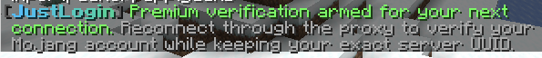
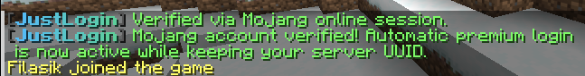

# Premium Login (`/premium`, `/unpremium`)

Players who own a Minecraft Java account can log in **automatically, without typing a password**, verified by Mojang – and **keep the same server UUID** they had before. Everything tied to that UUID (inventory, ender chest, permissions, economy, claims, homes...) stays attached.

## How it works for a player

1. Log in with the password as usual.
2. Run `/premium`. The next join will be verified by Mojang.
3. Reconnect with the same Minecraft account. JustLogin performs an encrypted handshake and checks the session with Mojang's session server (`hasJoined`). On success you are logged in automatically.

If the connecting client **cannot** present a verified Mojang session, JustLogin rolls the pending request back, so the player is never locked out of their account.

To go back: `/unpremium` (add a password only if the account has none yet, e.g. it was created automatically).

*Screenshots above are in-game captures from the project gallery.*

## The immutable `game_uuid`

Each account gets a permanent `game_uuid` on first join. It never changes when:

- the player toggles `/premium` / `/unpremium`,
- the Mojang account is renamed,
- an admin runs `/jl rename`.

`/jl merge <source> <target>` keeps the target's UUID.

## Standalone Paper

`premium.standalone-enabled: true` (default). No proxy, no ProtocolLib, no PacketEvents are needed: JustLogin plugs into Paper's Netty login pipeline, runs the Mojang encryption handshake, applies the Mojang skin textures and keeps the permanent UUID via `AsyncPlayerPreLoginEvent`.

It stays **idle** when `server.properties` has `online-mode=true` (Paper already verifies Mojang accounts) or when `proxy.enabled=true` (the proxy does it). If Paper's own proxy forwarding is enabled while `proxy.enabled=false`, JustLogin logs a warning and pauses the standalone hook.

`premium.fallback-to-password` (default `false`) lets premium-confirmed accounts that *have* a password use it when the hook is inactive.

## Behind Velocity / BungeeCord

The proxy module negotiates Mojang authentication and forwards a signed `justlogin:auth` message. Setup: [Proxy Setup](Proxy-Setup). Accounts marked premium that connect without Mojang verification receive *"This account requires Mojang verification through the network proxy."*

## Mojang username auto-detect

`premium.auto-detect-mojang` (Paper) / `proxy.auto-detect-mojang` (proxy) is **off by default**. When on, an unseen username is looked up at Mojang on first join. That is convenient, but it lets whoever connects first with a Mojang-owned name decide how that name is handled, so enable it only if you understand the trade-off ([Security Model](Security-Model)).

## Admin controls

- `/jl setpremium <player> <true|false>` – override the flag (UUID is kept).
- `/jl status <player>` – see `premium` / `premium_uuid` state.

## Privacy

Only the public player name and the server-id hash are sent to Mojang's session server. Passwords are never transmitted. See [Security Model](Security-Model#external-connections).
