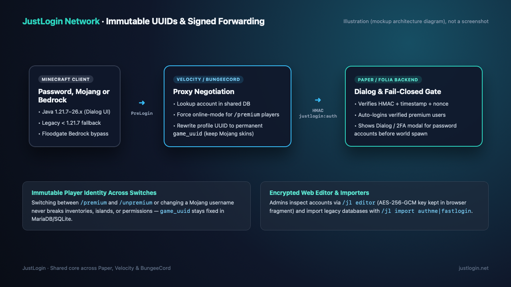

# Proxy Setup (Velocity and BungeeCord)

On a network, JustLogin runs on **both** the proxy and every Paper backend:

| Where | Jar |
| :--- | :--- |
| Velocity | `JustLogin-Velocity-<version>.jar` |
| BungeeCord / Waterfall | `JustLogin-Bungee-<version>.jar` |
| Every Paper backend | `JustLogin-<version>.jar` |



*Illustration, not a screenshot.*

The proxy handles Mojang negotiation and UUID rewriting at the network edge, then forwards an **HMAC-SHA256 signed** `justlogin:auth` message (timestamp + single-use nonce) to the Paper backend. The backend only trusts a connection when the signature, nonce and timestamp are valid.

## Checklist

1. **Generate a secret** – at least 16 random characters (a long random string is better).
2. **Proxy `config.yml`** – set `proxy.shared-secret` to that secret. The default placeholder `CHANGE-ME-TO-A-LONG-RANDOM-SECRET` is rejected.
3. **Every Paper `config.yml`** – set the *same* `proxy.shared-secret`, `proxy.enabled: true` and `proxy.mode: velocity` (or `bungee`).
4. **Same database everywhere** – use `storage.type: mariadb` with identical settings on the proxy and all backends (see [Storage and Database](Storage-and-Database)). SQLite is only suitable for one server.
5. **Paper forwarding must match** (JustLogin verifies it at startup):
   - Velocity: `config/paper-global.yml` → `proxies.velocity.enabled: true` and a non-empty `proxies.velocity.secret`.
   - BungeeCord: `spigot.yml` → `settings.bungeecord: true`. Legacy forwarding is spoofable, so firewall the backend ports and install BungeeGuard.
6. **Firewall** – backends must only be reachable from the proxy.
7. Restart the proxy and the backends.

## Paper backend options

```yaml
proxy:
  enabled: true
  mode: velocity            # velocity | bungee
  shared-secret: "<same secret as the proxy>"
  require-forwarding-config: true   # leave on; verifies paper-global.yml / spigot.yml
```

If anything is wrong, JustLogin **fails closed**: players are refused instead of being let in unauthenticated. Typical startup errors:

| Message | Fix |
| :--- | :--- |
| `proxy.enabled=true cannot use proxy.mode=standalone` | Set `proxy.mode` to `velocity` or `bungee` |
| `proxy.shared-secret is empty` / `must be at least 16 characters` | Set a long secret |
| `proxies.velocity.enabled is false in config/paper-global.yml` | Enable Velocity forwarding in Paper |
| `settings.bungeecord is false in spigot.yml` | Enable BungeeCord forwarding |

## Proxy options (`config.yml` on Velocity / BungeeCord)

| Key | Default | Meaning |
| :--- | :--- | :--- |
| `locale` | `en` | `en`, `cs` or `sk` for proxy messages |
| `metrics` | `true` | bStats toggle |
| `username.regex` | `^[a-zA-Z0-9_]{3,16}$` | Allowed usernames (checked before any lookup) |
| `proxy.shared-secret` | placeholder | Must match Paper |
| `proxy.auto-detect-mojang` | `false` | Look up unseen usernames at Mojang on first join (opt-in, see [Security Model](Security-Model)) |
| `proxy.mojang-cache-seconds` | `300` | Cache of Mojang lookups |
| `proxy.floodgate-fallback` | `true` | Let Floodgate (Bedrock) players through the password flow |
| `proxy.auth-servers` | `[]` | Backend server names that act as an auth / lobby server. When set, unauthenticated players cannot switch away from them |
| `skins.*` (Velocity) | enabled | Apply saved `/skin` textures and optional name-matched skins |
| `storage.*` | SQLite | Use MariaDB for multiple backends |
| `messages.*` | English | Proxy-side kick messages |

## Auth / lobby servers

Set `proxy.auth-servers: [lobby]` (names from your proxy's server list). Until the backend confirms authentication, the player is held on those servers and server-switch attempts show *"Please authenticate before switching servers."*

## Verifying the setup

1. Start everything and check that the proxy and each backend print the JustLogin banner.
2. Join through the proxy and register.
3. `/jl status <name>` on a backend should show the account.
4. Try connecting directly to a backend port from outside – it must be refused by your firewall.
