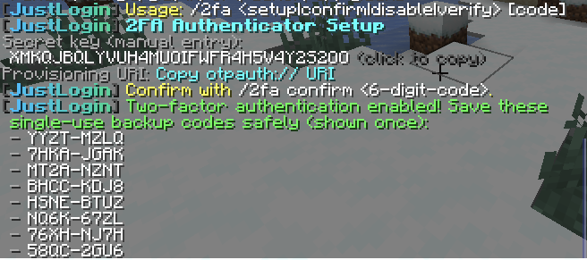

# Two-Factor Authentication

JustLogin supports **RFC 6238 TOTP** (Google Authenticator, Aegis, 2FAS, Bitwarden, Authy, ...). It is available to everyone with `justlogin.2fa` (default: everyone).

## Enable

1. `/2fa setup` – you receive the secret key and the `otpauth://` URI (both click-to-copy). If `totp.qr-map-enabled` is on, a **QR code appears on a map in your hand** – scan it with your authenticator app, or type the key in manually.
2. `/2fa confirm <6-digit code>` within 5 minutes.
3. **Eight single-use backup codes** are shown once. Store them safely.

Changed your mind? `/2fa cancel` discards the pending setup and hides the QR map. Running `/2fa setup` again replaces the previous pending secret.

## The QR map

Since 1.0.5 (`config-version: 8`) the setup can show the authenticator QR code on a map:

- The map is **client-only**. JustLogin sends a fake item to your held slot and draws the QR locally; your real inventory and the world's map storage are never touched, and no external QR service is used (the code is generated on the server).
- It disappears after **120 seconds at most**, and immediately when you confirm or cancel, switch hotbar slots, drop / swap / use an item, open or click an inventory, interact with blocks or entities, change game mode, teleport, die, or disconnect. The original slot is then restored from the server's real inventory and the map pixels are blanked.
- On server shutdown every open QR map is blanked and the slot restored.
- If the QR cannot be shown on your client or server, you get *"QR map unavailable"* and simply use the manual key.
- To switch it off, set `totp.qr-map-enabled: false`. Manual setup with the key / URI keeps working.

> The QR code contains your 2FA secret. Don't screenshot it or stream while it is visible. A modified client could also keep a copy. 2FA is only switched on after you enter a valid first code, and a pending setup expires after five minutes.

## Log in

After the password, the dialog (or `/2fa verify <code>`) asks for a 6-digit code **or** a backup code.

## Disable

`/2fa disable <code>` – requires a valid current code or backup code so a hijacked session cannot simply remove 2FA.

## Server-side details

- Secrets are encrypted with **AES-256-GCM** using the key in `plugins/JustLogin/secrets.key`, which is kept **separate from the database**. Leaked SQL dumps alone do not reveal 2FA secrets.
- Each accepted TOTP time-step is remembered, so a code cannot be replayed.
- Backup codes are stored hashed and each works once.
- A pending setup secret is consumed atomically on confirmation, so `/2fa cancel` or a second `/2fa setup` cannot race an in-flight confirmation. The pending secret is redacted from logs and debug output.
- `totp.window-steps` allows ± 30 s clock drift per step; `totp.issuer` is the label in the app.

## Lost device or lost `secrets.key`

- Player lost the phone: `/jl reset2fa <player>`.
- `secrets.key` lost or replaced: existing 2FA secrets can no longer be decrypted (the player sees *"Could not verify 2FA secret due to a server key error"*). Reset them with `/jl reset2fa`. **Back up `secrets.key` together with your database.**

## Tips for server owners

- Set `totp.issuer` to your server name.
- Consider requiring staff accounts to use 2FA (enforce it through your own policy; JustLogin leaves it optional for players).
