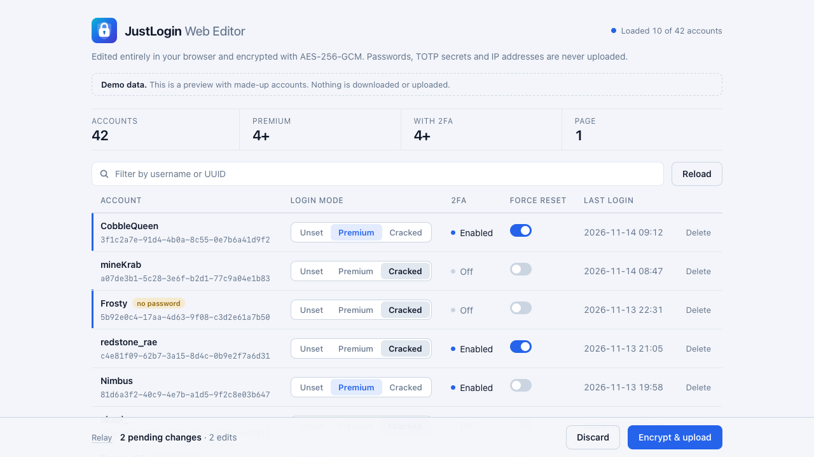

# Web Editor

A browser UI for reviewing and bulk-editing accounts, with **end-to-end encryption**: the server encrypts a snapshot with **AES-256-GCM** and the key only ever lives in the URL `#fragment`, which browsers never send to any server.

*Rendered with made-up demo accounts; not a game screenshot.*

## Workflow

1. Run `/jl editor [page]` in-game (permission `justlogin.editor`). You get a link.
2. Open it. The editor decrypts the snapshot **in your browser**. Change the login mode, the force-reset flag or 2FA status of accounts.
3. Press **Encrypt & upload**. You get a short code.
4. In-game: `/jl applyedits <code>` – shows the diff for review.
5. If it is correct: `/jl applyedits confirm`.

Nothing changes on the server until you confirm. Snapshots expire after `editor.ttl-seconds` (default 30 min) and are split into pages of `editor.page-size` accounts (default 500). Accounts are ordered by **most recent login first**, so page 1 holds your active players; accounts that never logged in come last.

The link carries the relay address, so the browser always reads from and writes to the same relay as your server. The decryption key stays in the `#fragment` and is never sent to the relay.

## Hosted vs. local

| Mode | How |
| :--- | :--- |
| Hosted (default) | `editor.web-url: https://justlogin.net`, encrypted data stored at `editor.relay-url` (`https://bytebin.justlogin.net`, a Bytebin-compatible relay run by JustLogin) |
| Own relay | Set `editor.relay-url` to your own Bytebin instance; the hosted editor follows the URL in the link |
| Local only | `editor.local-http.enabled: true` – serves the editor and a temporary relay on `http://127.0.0.1:8787/` (`bind` / `port` configurable); nothing leaves the machine |

For strict privacy, use the local mode or `/jl gui`.

## Privacy

The snapshot contains account names, UUIDs and flags (premium, has-password, 2FA enabled, force-reset, timestamps) but **never password hashes, TOTP secrets or IP hashes**. It is encrypted, yet the encrypted blob is still stored on the relay until it expires. The relay cannot read it. If you do not want a third-party relay in the loop at all, use local mode. See [Security Model](Security-Model#external-connections).
